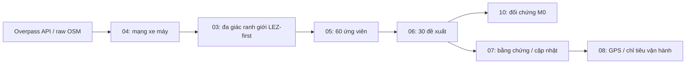

# Tuyến khảo sát xe máy Hà Nội theo LEZ

Quy trình Python lấy OSM qua Overpass API, dựng mạng xe máy có hướng, sinh **60 ứng viên A20/B20/C20**, chọn **30 tuyến đề xuất A10/B8/C12**, đối chứng ngẫu nhiên và chuẩn bị khảo sát/GPS. Bộ 30 gồm **18 tuyến trong / 12 tuyến ngoài LEZ 2030**.

Đây là thiết kế **tiền khảo sát**. Hình học OSM là proxy kỹ thuật có truy vết nguồn; bộ tuyến chưa được xác minh đầy đủ về GIS chính thức, quyền lưu thông và điều kiện thực địa. Các nguồn chính sách được đóng băng trong cấu hình, không được coi là tra cứu pháp luật cập nhật theo thời gian thực.

## Bắt đầu đọc và sử dụng

| Bạn cần gì? | Tài liệu |
|---|---|
| Hiểu mục tiêu, dữ liệu, phương pháp và phần còn thiếu | [Tổng quan dự án](docs/PROJECT_OVERVIEW.md) |
| Thao tác từ đầu đến cuối trong dự án đã có dữ liệu | [Hướng dẫn sử dụng](HUONG_DAN_SU_DUNG_WORK.md) |
| Clone repo, cài môi trường, khôi phục dữ liệu trên máy khác | [Bắt đầu trên máy mới](docs/setup/GETTING_STARTED.md) |
| Chạy 1.000 bộ ngẫu nhiên và đọc kết quả | [M0](docs/lez/RANDOM_BASELINE.md) · [Notebook 10](notebooks/10_random_baseline.ipynb) |
| Tìm hướng dẫn theo từng phần | [Mục lục tài liệu](docs/README.md) |

Trong tài liệu, `.../work` là thư mục gốc repo; không chứa đường dẫn tài khoản cá nhân. Dấu `...` không phải ký tự để chép vào lệnh Terminal.

## Dòng xử lý



[Notebook 09](notebooks/09_automate_project.ipynb) điều phối các bước hiện có đến xử lý chuyến đo, gồm độ nhạy, bản đồ, T2 và T3/T5. **M0 chạy riêng ở notebook 10.** Chạy lại với cache hợp lệ để tiếp tục; không cần tải lại OSM chỉ để xem hoặc so sánh bộ tuyến.

Phân vùng theo cấu hình LEZ-first: **A** là KV1/KV2/KV3 thí điểm 2027 tại Hoàn Kiếm/Cửa Nam; **B** là LEZ 2030 trừ A; **C** là phần Hà Nội ngoài LEZ 2030. A không đồng nghĩa toàn Vành đai 1. `sampling_zone` và trạng thái trong/ngoài LEZ là hai thuộc tính riêng. Nguồn và phiên bản: [lez_policy.json](config/lez_policy.json).

## Kết quả đã kiểm tra ngày 02/11/2026

| Nội dung | Kết quả trên dữ liệu lưu tại máy |
|---|---|
| OSM | 183 ô hợp lệ; snapshot `2026-10-01T00:00:00Z` |
| Bộ ứng viên / bộ đề xuất | 60 A20/B20/C20 → 30 A10/B8/C12 |
| D của bộ 30 | **0,365187**; D càng nhỏ thì cơ cấu chiều dài RC càng gần mạng tham chiếu |
| M0, seed `20261102` | 1.000 bộ hợp lệ; D trung bình **0,542052**; thấp nhất **0,414540** |
| Bộ ngẫu nhiên có D ≤ D bộ gốc | **0/1.000**, thống kê mô tả; không diễn giải thành p-value bằng 0 |
| Độ nhạy tiền khảo sát | 114 kịch bản: 113 hoàn thành, 1 ca thiếu quota được định trước |
| Đo thực tế | 0 chuyến / 0 điểm GPS trong báo cáo dữ liệu thực |
| Giới hạn ô RC | Pool có tuyến ở 11/12 ô; thiếu A×RC1 |

Xem [bản kết quả M0 được lưu trong repo](docs/results/M0_2026_11_02.md), gồm biểu đồ, bảng chỉ tiêu, danh sách các bộ và hash nguồn. Các số trên là một phiên bản đã kiểm tra, không tự thay đổi khi chạy phiên bản mới. D không phải tỷ lệ đường đã khảo sát; 0/1.000 không chứng minh bộ gốc tối ưu toàn cục.

## Chạy nhanh khi đã có dữ liệu tương ứng

Từ thư mục gốc repo, bằng Python có NumPy và Matplotlib:

```bash
python3 scripts/lez/selection_random.py preflight
python3 scripts/lez/selection_random.py run
```

M0 đọc bundle mạng, 60 ứng viên, bộ 30 và gate đã lưu; không khởi động QGIS hoặc gọi HTTP. `preflight` dừng nếu thiếu nguồn/hash. Muốn dựng lại mạng/hình học cần runtime PyQGIS phù hợp; đọc [cài đặt](docs/setup/GETTING_STARTED.md) trước khi chạy notebook 09.

## Nội dung repo và dữ liệu cần khôi phục

| Được lưu trên GitHub | Được sinh hoặc lưu riêng tại máy |
|---|---|
| Mã nguồn, notebook, cấu hình, kiểm thử | Response OSM từng ô và manifest tải |
| Truy vấn, metadata ô, tài liệu nguồn đã theo dõi | Graph, GeoPackage và bundle xử lý lớn |
| Hướng dẫn và bản kết quả M0 ngày 02/11 | Báo cáo `latest_*`, bản đồ HTML/GPX và checkpoint |
| | Bằng chứng khảo sát và dữ liệu đo |

Clone repo cung cấp mã và tài liệu; để tái chạy cần khôi phục hoặc dựng các đầu vào theo [hướng dẫn máy mới](docs/setup/GETTING_STARTED.md). [.gitignore](.gitignore) giữ các kết quả sinh tự động ngoài Git; bản M0 trong `docs/results` là bản kết quả được chọn riêng để đọc và kiểm tra trên GitHub.

## Hướng phát triển

Hoàn thiện đối chứng M1–M5, kiểm tra thay đổi đa giác ranh giới, xác minh tuyến/neo và C6, thu GPS/tốc độ, đánh giá đủ dữ liệu rồi xây dựng/kiểm định chu trình lái. M0, độ nhạy trên pool cố định và lịch dự kiến không thay thế bằng chứng thực địa. Chi tiết tại [phần việc còn lại](docs/PROJECT_OVERVIEW.md#cong-viec-con-lai).

Dữ liệu nền: © OpenStreetMap contributors. Xem [thông tin bản quyền OSM](https://www.openstreetmap.org/copyright); tài liệu và nguồn khác giữ thông tin xuất xứ tương ứng.
