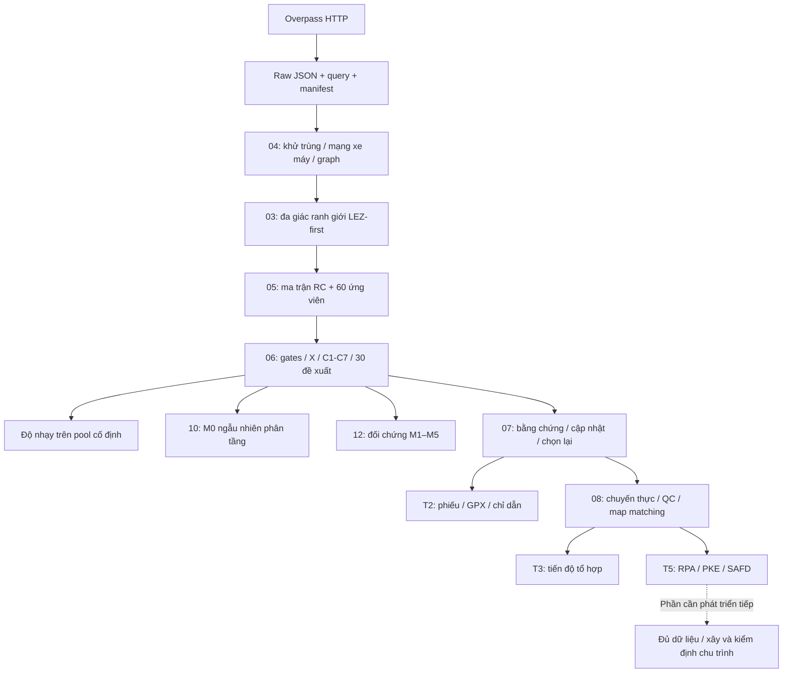

# Tổng quan dự án khảo sát xe máy Hà Nội theo LEZ

Cập nhật ngày **02/11/2026**, theo mã nguồn và báo cáo đã lưu của dự án. Mục tiêu là xây dựng một bộ tuyến có thể truy vết và kiểm tra để tổ chức khảo sát xe máy trong/ngoài LEZ, sau đó thu dữ liệu vận hành phục vụ nghiên cứu chu trình lái.

## Câu hỏi và đơn vị phân tích

Ở bước chọn tuyến, dự án tìm một tập 30 tuyến từ pool 60 ứng viên đáp ứng phân vùng/quota, có cơ cấu chiều dài đường gần mạng tham chiếu, hạn chế trùng và bổ sung đặc trưng. Ở bước thực địa, mỗi chuyến đo là một lần chạy tuyến với thời gian, thiết bị, điều kiện và chuỗi điểm GPS/tốc độ riêng.

| Đối tượng | Vai trò |
|---|---|
| Ô tải OSM | Chia truy vấn HTTP, không phải tuyến khảo sát |
| Phần đường vật lý | Đơn vị chiều dài mạng và độ phủ duy nhất |
| Cung có hướng / lượt đi | Kiểm chiều, rẽ, liên tục; một phần vật lý có thể được đi nhiều lần |
| Tuyến ứng viên | Chuỗi cung có thứ tự, ID A01–C20, ABC, LEZ, RC và điểm neo |
| Bộ 30 | Đơn vị đánh giá D, độ phủ, đa dạng và các quota |
| Chuyến / điểm đo | Dữ liệu thực nghiệm, tách khỏi thông tin OSM và mô hình chấm điểm |

`tiles.csv` là danh mục ô tải, không phải dataset tổng hợp 60 tuyến. Dataset ứng viên xuất ở `candidate_routes.csv`; dataset được chọn ở `selected_routes.csv` trong bundle tương ứng.

## Phạm vi không gian và mẫu

Các đa giác ranh giới nghiên cứu được dựng theo nguồn chính sách đóng băng trong [cấu hình LEZ](../config/lez_policy.json) và hình học OSM có ghi nhận bất định.

| Nhóm | Định nghĩa của phiên bản hiện tại | Pool | Bộ đề xuất |
|---|---|---:|---:|
| A | KV1/KV2/KV3 thí điểm LEZ 2027 tại Hoàn Kiếm/Cửa Nam | 20 | 10 |
| B | LEZ 2030 trừ A, bao gồm phần trong Vành đai 1 chưa thuộc A và phần mở rộng đến Vành đai 3 | 20 | 8 |
| C | Hà Nội ngoài LEZ 2030 | 20 | 12 |
| Tổng | Bộ 30 có 18 trong / 12 ngoài LEZ 2030 | 60 | 30 |

Ma trận tham chiếu giữ đủ **12 ô ABC × RC1–RC4**, kể cả ô chưa có tuyến. Trong pool hiện tại, A×RC1 không có hành lang đủ điều kiện sinh tuyến sau kiểm tra thuần vùng và loại dải bất định. Có chiều dài mạng RC1 giao A không đồng nghĩa có tuyến đủ điều kiện trong A. Xem [giới hạn A×RC1](lez/A_RC1_LIMITATION.md).

Đây là phiên bản nghiên cứu dựa trên các nguồn lưu trước đó, không phải kết luận về tình trạng pháp lý mới nhất ngày đọc tài liệu. Thay nguồn chính sách hoặc đa giác ranh giới phải tạo phiên bản và tính lại các bước phụ thuộc.

## Kiến trúc và thứ tự xử lý



Python thường xử lý HTTP, bảng, controller và M0. Worker PyQGIS thực hiện phần hình học/routing/bản đồ phụ thuộc QGIS. GeoPackage/SQLite được dùng nội bộ; người chạy không phải dựng SQL server hoặc tự viết SQL. Overpass đọc dữ liệu không cần API key trong cách tích hợp hiện tại. QuickOSM không phải phụ thuộc của pipeline Python.

Notebook 09 điều phối các bước đã tích hợp; notebook 10 chạy M0 riêng. Notebook 12 chạy M2/M3, đọc lịch sử M4/M5 và có mục riêng để chạy M1/M2b theo cùng quota RC và đối chiếu M2a đã lưu. Số notebook không phải thứ tự dựng mới: **04 đứng trước phần hình học 03**, rồi 05 → 06. Phần V/N và chuẩn hóa dân cư trong notebook 03 là đối chiếu lịch sử có guard, không thay cách phân A/B/C hiện hành.

## Phương pháp chọn và đánh giá

G1–G6 tách quyền đi, liên tục/chiều/rẽ, thuần vùng, ổn định công trình, khả năng lặp và an toàn neo/dừng. Graph và hình học đã có kiểm tự động; phần pháp lý/thực địa cần chứng cứ. C6 thô còn thiếu; giả định trung tính chỉ phục vụ chấm điểm tiền khảo sát, không trở thành quan sát.

Chín biến X gồm tỷ trọng RC1–RC4, số làn, giới hạn tốc độ OSM, mật độ nút giao, tín hiệu và phần một chiều. Chấm C1–C7 bằng greedy có quota, nhiều khởi tạo và swap giảm D. Đây là heuristic hữu hạn, không phải lấy top 30 từ một bảng điểm cố định hoặc chứng minh nghiệm tối ưu toàn cục.

Với 12 ô `i`, các mẫu số được cố định như sau:

```text
q_i = chiều dài mạng RC đủ điều kiện của ô i / tổng chiều dài mạng RC1–RC4
p_i(S) = chiều dài lượt đi RC của bộ S trong ô i / tổng chiều dài lượt đi RC1–RC4 của S
D(S) = 0,5 × Σ_i |q_i − p_i(S)|
Độ phủ duy nhất = chiều dài hợp các phần RC được S đi qua / tổng chiều dài mạng RC1–RC4
```

Trong D, phần dùng chung được đếm theo mỗi lượt đi; connector được tách khỏi mẫu số RC. Độ phủ duy nhất chỉ đếm mỗi phần vật lý một lần. D nhỏ hơn thể hiện cơ cấu chiều dài gần hơn, không đo lượng khảo sát đã hoàn tất. D riêng trong/ngoài dùng lớp giao LEZ tường minh và mẫu số riêng.

## Hiện trạng đã xác minh

| Phần | Có mã/chức năng | Bằng chứng hiện có |
|---|---|---|
| OSM / mạng / 60 / 30 | Có | 183 ô hợp lệ, snapshot 01/10/2026; 60 và 30 đạt quota kỹ thuật |
| C1–C7 + swap | Có | D bộ 30 `0.36518658692754424`, 2 swap được nhận |
| M0 | Có, độc lập notebook 10 | 1.000 bộ hợp lệ, seed `20261102`; [kết quả](results/M0_2026_11_02.md) |
| Độ nhạy tiền khảo sát | Có | 114 kịch bản, 113 hoàn thành và 1 ca thiếu quota định trước |
| T2 | Có | Chỉ dẫn/GPX/phiếu đã xuất; còn chờ rà soát thực địa |
| T3 | Có | 180 tổ hợp, 360 lượt dự kiến; 0 tổ hợp được đếm đã đo; mục tiêu chuyến/ngày chưa chốt |
| GPS và T5 | Có | Báo cáo dữ liệu thực có 0 chuyến / 0 điểm; công thức có kiểm bằng ví dụ tách riêng |
| GIS chính thức / đo thực | Cần đầu vào | `official_gis_verified=false`, `measurement_verified=false` |

Các số này là ảnh chụp kiểm tra ngày 02/11/2026. Xem `latest_*` tại máy để biết phiên bản hiện hành; nhật ký điều phối tổng có thể cũ hoặc dừng giữa chừng, không thay báo cáo từng bước.

## Đối chứng M0 và giới hạn diễn giải

M0 bốc đều, độc lập trong các nhóm quota A-trong 10/B-trong 8/C-ngoài 12; không lặp ID trong một bộ. Loại toàn bộ bộ vi phạm điều kiện cứng chung rồi bốc lại đến đủ 1.000 bộ hợp lệ. Không sửa bộ bằng swap, không lọc theo D hoặc ép có 11 ô. Bộ giống nhau giữa các lần độc lập được giữ lại theo thiết kế.

D ngẫu nhiên trung bình `0.542052`, nhỏ nhất `0.414540`; không có bộ nào trong 1.000 bộ có D không lớn hơn `0.365187` của bộ gốc. Đây là thống kê mô tả trên pool cố định; không phải p-value bằng 0 hoặc bằng chứng đại diện mọi tuyến Hà Nội. Các phân vị M0 là phân phối bộ ngẫu nhiên, không phải khoảng tin cậy cho mạng Hà Nội.

Độ nhạy hiện có không bao gồm đầy đủ việc thay đa giác ranh giới, sinh lại pool và so trên một mạng tham chiếu chung; nó không thay thế các phương pháp đối chứng độc lập. Notebook 12 chạy M2/M3 và kiểm/trích M4/M5 từ cùng lịch sử chọn tuyến; mục M1/M2b dùng quota tuyến theo vùng × RC và đối chiếu với M2a đã lưu và kiểm lại. Xem [hướng dẫn đối chứng](lez/SELECTION_BENCHMARKS.md).

<a id="cong-viec-con-lai"></a>

## Công việc còn lại

1. Hoàn thiện diễn giải bảng M0–M5 và các đánh đổi D, độ phủ, chiều dài khảo sát. Có thể thử mục tiêu chiều dài tuyệt đối hoặc khởi đầu ba tuyến, mỗi vùng một tuyến, như các kiểm tra độ nhạy riêng; xem [hướng dẫn đối chứng](lez/SELECTION_BENCHMARKS.md).
2. Thiết kế các kịch bản đổi đa giác ranh giới, overlay/mạng/pool phù hợp, tính D theo mạng kịch bản và theo một mạng tham chiếu chung.
3. Xác minh tuyến/neo, biển báo/quyền đi, công trình, khả năng lặp, an toàn, số làn/tốc độ và C6 bằng chứng cứ thực địa. Cập nhật qua overlay rồi tính lại toàn bộ bộ 30.
4. Chốt thiết kế số lượt/ngày, thu GPS/tốc độ, kiểm chất lượng và theo dõi các tổ hợp. Lịch 360 lượt là đề xuất, không phải cỡ mẫu bắt buộc đã kiểm định.
5. Đánh giá hội tụ/đủ dữ liệu và xây dựng, kiểm định chu trình lái; đây là bước nghiên cứu tiếp theo, không tự được tạo từ OSM hoặc M0.

## Truy vết và sử dụng lại

Mỗi bundle có manifest, fingerprint, hash đầu vào/đầu ra, cấu hình và phiên bản. Đọc đường dẫn qua `lez.common.input_path`, không sửa bundle đã hash hoặc nối thêm một tiền tố `work/`. GitHub lưu mã, tài liệu và bản kết quả M0 đã chọn; dữ liệu lớn/quan sát được khôi phục riêng. Xem [máy mới](setup/GETTING_STARTED.md) và [hướng dẫn thao tác](../HUONG_DAN_SU_DUNG_WORK.md).
