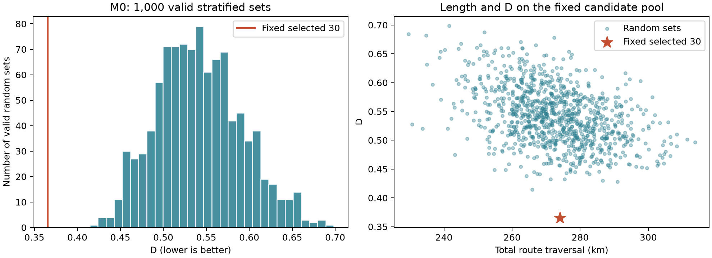

# M0 — kết quả đối chứng ngày 02/11/2026

Đối chứng ngẫu nhiên trên **cùng pool 60 ứng viên** và bộ 30 cố định của phiên bản nghiên cứu LEZ-first. Đây là kết quả tiền khảo sát được chọn để lưu trong Git; không phải báo cáo dữ liệu đo.

## Thiết kế lượt chạy

| Thuộc tính | Giá trị |
|---|---|
| Snapshot OSM | `2026-10-01T00:00:00Z` |
| Bộ 30 gốc | A10/B8/C12 = 18 trong / 12 ngoài LEZ 2030 |
| M0 | 1,000 bộ hợp lệ / 1,000 lần bốc; 1,000 bộ khác nhau |
| Seed / RNG | `20261102` / NumPy PCG64 |
| Điều kiện chung | Pool đã qua gate tiền khảo sát, quota/tầng bắt buộc, trùng hành lang vật lý từng cặp < 0,7 |
| Bộ bị loại | 0 trong lượt này; cơ chế loại vẫn áp dụng |
| Môi trường | Python 3.14.2, NumPy 2.4.4, Matplotlib 3.11.0 |
| Fingerprint lượt gốc | `c0dab6f8b0b424a196759e275fde355644949ce572788eb176cf8428ce6ce953` |

Mỗi lần bốc đều trong nhóm quota, không lặp ID trong bộ. Nếu vi phạm thì loại cả bộ và bốc lại; không sửa bằng greedy/swap. Bộ giống nhau giữa các lần độc lập vẫn được phép theo protocol, dù lượt này nhận 1.000 bộ khác nhau. Không lọc theo D, chiều dài, số ô hoặc độ đa dạng; không buộc bộ ngẫu nhiên có 11 ô vật chất.

## D và kết quả

D = 0,5 × Σ|q_i − p_i(S)| trên 12 ô ABC×RC1–RC4. `q_i` dùng chiều dài mạng vật lý đủ điều kiện; `p_i(S)` dùng chiều dài lượt đi của bộ mẫu. Mỗi tỷ trọng chia tổng RC1–RC4 tương ứng; connector tách riêng. D nhỏ hơn là cơ cấu chiều dài gần mạng tham chiếu hơn, không phải phần trăm đường đã đo.

| Thống kê D | Giá trị |
|---|---:|
| Bộ 30 cố định | **0.365187** |
| M0 trung bình | 0.542052 |
| M0 độ lệch chuẩn | 0.049731 |
| M0 trung vị | 0.539554 |
| M0 nhỏ nhất / lớn nhất | 0.414540 / 0.698412 |
| M0 phân vị 2,5% / 97,5% | 0.455072 / 0.647901 |
| Bộ M0 có D không lớn hơn bộ gốc | **0/1000** |

Bộ gốc có tổng lượt đi **274.031 km**, riêng RC **263.170 km**; phủ RC duy nhất **240.899 km**, bằng **1.074196%** mạng RC tham chiếu. Độ phủ đếm mỗi phần đường vật lý một lần; khác tổng lượt đi. Có tuyến ở 11/12 ô, thiếu A×RC1; ô và mẫu số vẫn được giữ.

Đối chiếu phụ đã cấu hình trước trong khoảng ±10% tổng chiều dài bộ gốc giữ **953 bộ**; có **0/953** bộ có D không lớn hơn bộ gốc. Đây là mô tả tập con, không thay 1.000 bộ chính hoặc điều kiện nhận bộ.

**Giới hạn:** tỷ lệ 0/1.000 là quan sát trong mô phỏng, không phải p-value bằng 0 hay xác suất thật bằng 0. Bộ gốc đã được tối ưu trên cùng pool; kết quả không chứng minh tối ưu toàn cục hoặc đại diện mọi tuyến Hà Nội. Các phân vị mô tả phân phối M0, không phải khoảng tin cậy cho mạng Hà Nội. GIS chính thức, quyền đi, C6 và số đo thực vẫn cần xác minh.

## Dataset và truy vết

| Tệp | Nội dung |
|---|---|
| [random_sets.csv](m0_2026_11_02/random_sets.csv) | 1.000 dòng; số lần bốc tích lũy, 30 ID cách nhau bằng `|` và chỉ tiêu từng bộ |
| [metric_summary.csv](m0_2026_11_02/metric_summary.csv) | Chỉ tiêu bộ gốc và thống kê M0; phần `q025`/`q975` là phân vị thực nghiệm |
| [route_frequency.csv](m0_2026_11_02/route_frequency.csv) | Tần suất được chọn của từng tuyến và cờ thuộc bộ gốc |
| [summary.json](m0_2026_11_02/summary.json) | Giá trị đầy đủ, quota, bộ gốc và giới hạn |
| [protocol.json](m0_2026_11_02/protocol.json) | Quy tắc bốc, loại và mẫu số |
| [provenance.json](m0_2026_11_02/provenance.json) | Hash nguồn/mã, runtime và bundle pool/bộ gốc |
| [checksums.json](m0_2026_11_02/checksums.json) | SHA-256 các tệp được lưu trong bản kết quả này |

Đây là bản lưu cố định của ngày kiểm tra, không tự theo con trỏ `latest_*`. Dataset được sao từ bundle gốc, không dựng lại số liệu để minh họa. Raw OSM, GeoPackage/graph và checkpoint lượt chạy nằm ngoài bản Git này. Tái chạy từ nguồn: [M0](../lez/RANDOM_BASELINE.md), [máy mới](../setup/GETTING_STARTED.md), [notebook 10](../../notebooks/10_random_baseline.ipynb).

Dữ liệu nền: © OpenStreetMap contributors. Dữ liệu OSM và phần dẫn xuất từ OSM được cung cấp theo [Open Database License 1.0 (ODbL)](https://opendatacommons.org/licenses/odbl/1-0/); xem [thông tin bản quyền OSM](https://www.openstreetmap.org/copyright).
